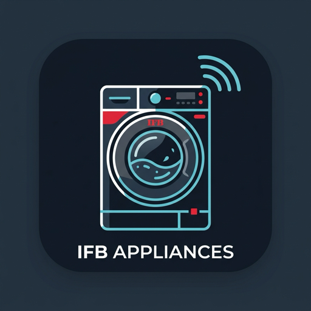

<p align="center">
  
</p>

# IFB Appliances Integration for Home Assistant

[](https://github.com/hacs/default)
[](https://github.com/NammaThalle/ha-ifb-appliances/releases)
[](https://opensource.org/licenses/MIT)

A Home Assistant custom integration and standalone Python library for **IFB Smart Home Appliances** (Washing Machines, Washer-Dryers, and compatible IoT models), reverse-engineered from the official *My IFB* mobile application (`com.sqt_smartapp.ifb_remote`).

Built for modern IFB machines equipped with the **Espressif ESP32** cloud module, communicating securely via Adobe Commerce GraphQL and IFB IoT cloud services (`mqttesp.ifbcloud.in:8887`).

---

## Features

- **Real-Time Telemetry & Sensors**:
  - Machine State (`standby`, `washing`, `rinsing`, `spinning`, `drying`, `steam`, `paused`, `complete`, `error`)
  - Active Program Name (full 14 dial programs with capability profiles)
  - Time Remaining (countdown in minutes)
  - Cycle Progress (0–100%)
  - Motor Speed (RPM)
  - Water Temperature (°C)
  - Water Level Pressure Frequency (Hz oscillation sensor)
  - Human-Readable Fault / Error Description (decoded from official APK alarm bitmasks)
  - Configured Spin Speed & Drying Mode
- **Binary Sensors**:
  - Running State (`binary_sensor.running`)
  - Door Locked (`binary_sensor.door_locked`)
  - Child Lock (`binary_sensor.child_lock`)
  - Tub Clean Reminder (`binary_sensor.tub_clean_reminder`)
  - Problem / Fault Detection (`binary_sensor.problem` with detailed error attributes)
  - Steam / Prewash / Soak active flags
- **Controls & Selectors**:
  - Program Selector (Express 15', Mix/Daily, Cotton, Synthetic, Anti-Allergen, Baby Wear, Bulky, Wash+Dry 2Hr, Wash+Dry 4Hr, Spin & Dry, Refresh, PowerSteam®, CradleWash®, Wool)
  - Spin Speed Selector (No Spin up to 1400 RPM)
  - Temperature Selector (Cold up to 95°C)
  - Drying Mode Selector (Cupboard Dry, Iron Dry, Extra Dry, Timed Dry 30-120m)
  - Hardware Buttons: **Start**, **Pause**, **Stop / Power Off**, and **Refresh**
- **Cooperative MQTT Listener & Options Flow**:
  - Persistent background MQTT connection for instant sub-second telemetry updates.
  - Automatic mobile app coexistence: yields MQTT session when the official *My IFB* app connects to eliminate session conflict loops.
  - User-configurable options for mobile app yield backoff (30–600s) and dynamic running/idle polling frequencies.
- **Native Diagnostics Support**:
  - Full Home Assistant Diagnostics export with sensitive tokens, credentials, and hardware IDs redacted.
- **Robust Authentication**:
  - Supports modern SMS OTP login (standard My IFB mobile flow), password login, or direct Bearer Token entry.
- **Zero External Dependencies**:
  - Fully bundled Python client library—no external pip packages required on Home Assistant Core.

---

## Installation

### Method 1: HACS (Recommended)

1. Open **HACS** in your Home Assistant sidebar.
2. Click the three dots in the top right corner and select **Custom repositories**.
3. Add the following repository:
   - **Repository**: `https://github.com/NammaThalle/ha-ifb-appliances`
   - **Type**: `Integration`
4. Click **Add**, find **IFB Appliances** in the store, and click **Download**.
5. Restart Home Assistant.

### Method 2: Manual Installation

1. Download the latest release `.zip` from [Releases](https://github.com/NammaThalle/ha-ifb-appliances/releases).
2. Copy the `custom_components/ifb_washer_cloud` directory into your Home Assistant `<config>/custom_components/` folder.
3. Restart Home Assistant.

---

## Configuration

1. In Home Assistant, navigate to **Settings** -> **Devices & Services**.
2. Click **Add Integration** and search for **IFB Appliances**.
3. Choose your preferred authentication method:
   - **Mobile Number (SMS OTP)** *(Recommended)*: Enter your 10-digit registered mobile number. You will receive an SMS OTP to verify.
   - **Password**: Enter your registered phone number or email and password.
   - **Direct Bearer Token**: Paste an existing active bearer token if you already have one.
4. If your appliance is not automatically returned by the IFB cloud catalog, the setup wizard will seamlessly prompt you to enter your machine's **MAC address** (printed on the barcode sticker on your appliance, or visible in your Wi-Fi router's client list).

---

## Automation Blueprints

Pre-packaged Home Assistant automation blueprints are included in `blueprints/automation/ifb_washer_cloud/`:

| Blueprint | Description | Import |
|---|---|---|
| **Laundry Finished Notification** | Sends actionable mobile push notification when cycle completes. | [](https://my.home-assistant.io/redirect/blueprint_import/?blueprint_url=https%3A%2F%2Fgithub.com%2FNammaThalle%2Fha-ifb-appliances%2Fblob%2Fmain%2Fblueprints%2Fautomation%2Fifb_washer_cloud%2Flaundry_finished_notification.yaml) |
| **Unattended Laundry Reminder** | Reminds you if clean clothes remain locked in the drum >30 mins after washing. | [](https://my.home-assistant.io/redirect/blueprint_import/?blueprint_url=https%3A%2F%2Fgithub.com%2FNammaThalle%2Fha-ifb-appliances%2Fblob%2Fmain%2Fblueprints%2Fautomation%2Fifb_washer_cloud%2Funattended_laundry_reminder.yaml) |
| **Tub Clean Due Alert** | Notifies when machine signals detergent residue or reaches 40 cycles. | [](https://my.home-assistant.io/redirect/blueprint_import/?blueprint_url=https%3A%2F%2Fgithub.com%2FNammaThalle%2Fha-ifb-appliances%2Fblob%2Fmain%2Fblueprints%2Fautomation%2Fifb_washer_cloud%2Ftub_clean_reminder.yaml) |

To use blueprints:
1. Copy the YAML files to your Home Assistant `<config>/blueprints/automation/ifb_washer_cloud/` directory, or use the "Import Blueprint" buttons above.
2. In Home Assistant, go to **Settings** -> **Automations & Scenes** -> **Blueprints**.
3. Click **Create Automation** next to the desired blueprint and select your washer entity.

---

## Dashboard Card: Animated Appliance Card

For an animated drum with cycle stages, pair this integration with [`ha-appliance-card`](https://github.com/ADNPolymerase/ha-appliance-card).

### Lovelace Dashboard YAML

```yaml
type: vertical-stack
cards:
  - type: custom:ha-appliance-card
    appliance_type: washer
    name: "IFB Washer Dryer"
    state_entity: sensor.ifb_washer_dryer_machine_state
    program_entity: sensor.ifb_washer_dryer_active_program
    remaining_time_entity: sensor.ifb_washer_dryer_time_remaining
    remaining_time_unit: minutes
    progress_entity: sensor.ifb_washer_dryer_progress
    start_entity: button.ifb_washer_dryer_start
    pause_entity: button.ifb_washer_dryer_pause
    stop_entity: button.ifb_washer_dryer_stop

  - type: entities
    title: "Cycle Settings & Controls"
    show_header_toggle: false
    entities:
      - entity: select.ifb_washer_dryer_program
        name: "Program"
      - entity: select.ifb_washer_dryer_temperature
        name: "Temperature"
      - entity: select.ifb_washer_dryer_spin_speed
        name: "Spin Speed"
      - entity: select.ifb_washer_dryer_dry_mode
        name: "Dry Mode"
      - type: divider
      - entity: binary_sensor.ifb_washer_dryer_door_locked
        name: "Door Lock"
      - entity: binary_sensor.ifb_washer_dryer_child_lock
        name: "Child Lock"
      - type: divider
      - entity: button.ifb_washer_dryer_start
        name: "Start Cycle"
      - entity: button.ifb_washer_dryer_pause
        name: "Pause Cycle"
      - entity: button.ifb_washer_dryer_stop
        name: "Stop / Power Off"
```

---

## Standalone Python Library

The bundled `ifb_cloud` library can also be used in standalone scripts:

```python
import asyncio
from ifb_cloud import IfbCloudClient

async def main():
    client = IfbCloudClient()
    
    # 1. Request SMS OTP
    await client.request_otp("98XXXXXXXX", calling_code="+91")
    otp = input("Enter OTP received on SMS: ")
    
    # 2. Verify OTP
    await client.verify_otp("98XXXXXXXX", otp, calling_code="+91")
    
    # 3. Discover appliances
    devices = await client.get_all_devices()
    for dev in devices:
        print(f"Found: {dev.name} ({dev.mac}) - Status: {'Online' if dev.is_online else 'Offline'}")
        
        # 4. Fetch live cycle progress
        progress = await client.get_device_progress(dev.mac)
        print(f"State: {progress.state}, Time Remaining: {progress.time_remaining_minutes} min")

    await client.close()

if __name__ == "__main__":
    asyncio.run(main())
```

---

## Architecture: Cooperative MQTT & Mobile App Coexistence

The IFB IoT cloud broker (`mqttesp.ifbcloud.in:8887`) permits only **one active subscriber per device MAC address** at a time. If two clients connect using the same client credentials, the broker terminates the older connection.

To provide instantaneous telemetry inside Home Assistant without conflicting with the official *My IFB* smartphone app:

1. **Persistent Listener**: Home Assistant establishes a persistent MQTT subscription to receive live 56-byte binary telemetry frames.
2. **Disconnect Detection**: When the user opens the official *My IFB* app, the app connects to the MQTT broker, causing Home Assistant's session to be cleanly disconnected by the broker.
3. **Cooperative Yield Backoff**: Upon receiving the broker's disconnect event, Home Assistant immediately enters a backoff period (default 180 seconds, configurable in Options Flow from 30 to 600 seconds) without attempting to reconnect. During this window, Home Assistant relies on cached telemetry and periodic lightweight status checks.
4. **Seamless Resume**: Once the user closes or finishes interacting with the smartphone app and the backoff window elapses, Home Assistant transparently re-subscribes to MQTT telemetry.

```text
[IFB Cloud Broker]
        │
        ├── Official Mobile App opens ──> Disconnects HA session (rc!=0)
        │                                        │
        │                                        ▼
        │                              [HA enters Backoff]
        │                              Yields MQTT session for 180s
        │                              No session thrashing or UI kick
        │                                        │
        └── User closes Mobile App ─────> Backoff expires ──> HA re-subscribes
```

---

## Troubleshooting & FAQ

<details>
<summary><b>1. "Invalid or expired OTP" error during login</b></summary>
The official IFB OTP expires in 5 minutes. Make sure you enter the code promptly. If you requested multiple OTPs, only the most recent code is valid.
</details>

<details>
<summary><b>2. Appliance does not appear after authentication</b></summary>
Some IFB models connect directly to the MQTT cloud bridge without being linked in the warranty registration store. If your machine is not auto-detected, the setup flow will ask for your appliance's MAC address. You can find this on the barcode label on your machine or inside your home router's DHCP client list.
</details>

<details>
<summary><b>3. Why did the My IFB app briefly reload when I opened it?</b></summary>
Because the IFB broker limits concurrent MQTT subscribers, Home Assistant automatically yields the session the instant your phone connects. If you encounter any brief reloads, ensure you have updated to v1.2.0 or higher, where the cooperative backoff prevents repeated reconnect loops. You can adjust the yield backoff duration under **Configure** in Home Assistant.
</details>

<details>
<summary><b>4. What do the error codes (E01–E15) mean?</b></summary>
The integration automatically parses the machine's internal alarm bitmasks and displays human-readable descriptions under <code>sensor.*_error_description</code>:
<ul>
  <li><b>E01</b>: Door Unlocked</li>
  <li><b>E02</b>: Water Overflow</li>
  <li><b>E03</b>: Pressure Switch Failure</li>
  <li><b>E04</b>: Motor Drive Failure</li>
  <li><b>E05</b>: Triac Short Circuit</li>
  <li><b>E06</b>: Overheat Protection</li>
  <li><b>E07</b>: Door Lock Failure</li>
  <li><b>E08</b>: No Water Supply</li>
  <li><b>E09</b>: Low Water Pressure</li>
  <li><b>E10</b>: Heater Element Fault</li>
  <li><b>E11</b>: NTC Temperature Sensor Fault</li>
  <li><b>E12</b>: Drain Pump Failure</li>
  <li><b>E13</b>: Low Supply Voltage (&lt;170V)</li>
  <li><b>E14</b>: High Supply Voltage (&gt;270V)</li>
  <li><b>E15</b>: Unbalanced Drum Load</li>
</ul>
</details>

<details>
<summary><b>5. How do I download Diagnostics for troubleshooting?</b></summary>
Go to <b>Settings</b> -> <b>Devices & Services</b> -> <b>IFB Appliances</b> -> click the three dots on the integration entry -> <b>Download diagnostics</b>. All sensitive credentials, tokens, phone numbers, and hardware MAC addresses are automatically redacted.
</details>

<details>
<summary><b>6. Is my local machine IP or MAC address shared publicly?</b></summary>
No. The integration connects solely from your Home Assistant instance to the IFB cloud endpoints using your own account credentials. No network traffic or telemetry is shared with third parties.
</details>

---

## License

This project is licensed under the [MIT License](LICENSE).
